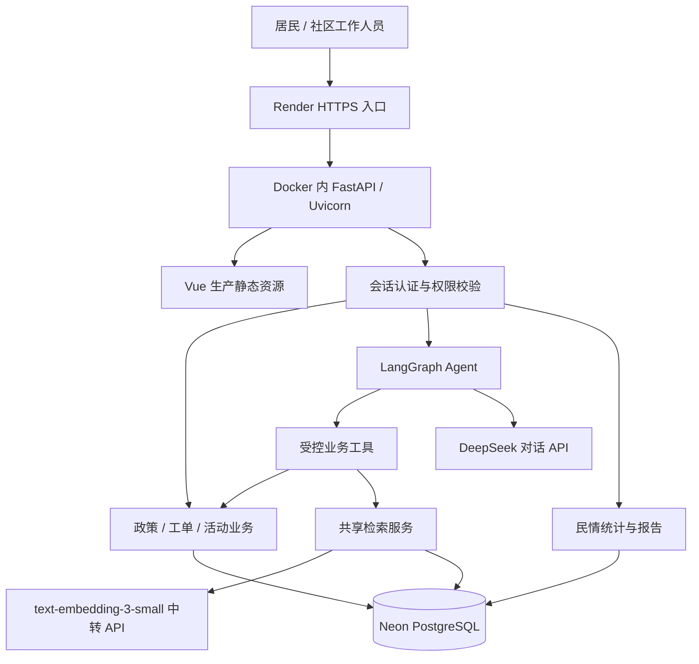
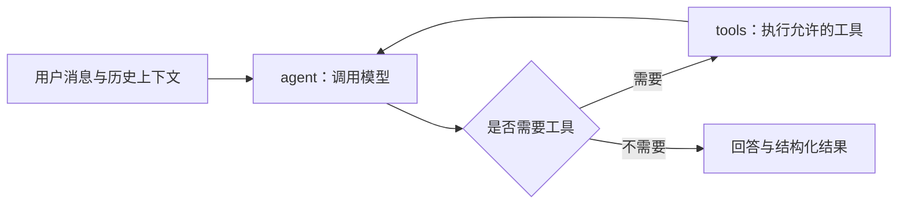

# 社区智能服务 Agent 项目技术方案

**项目名称：** 邻里智服——社区智能服务与民情分析平台  
**编写日期：** 2026年10月22日  
**方案依据：** 当前项目源码、依赖清单、部署配置及既有实施记录  
**适用范围：** Web 前后端、Agent 与知识库、数据存储、安全控制及云端部署

> 本方案描述已经实现的技术架构，并单列后续建设建议。旧版开发记录中涉及的 SQLite 单库方案、示例身份及未实现提醒等表述，以当前代码为准。文档不包含密码、数据库连接串或 API 密钥；历史检查结果不等同于本次重新完成测试。

## 一、项目目标与建设范围

本项目面向社区居民和社区工作人员，提供政策查询、办事指引、报事报修、活动报名、知识库管理和民情分析。居民可以通过自然语言描述需求，由 Agent 检索资料、返回内容与服务入口，并在必要时进入表单确认业务操作。

当前交付形态为浏览器访问的 Web 平台，包含居民端和管理员工作台，暂未建设小程序或独立手机 App。

### 1.1 主要功能

| 功能模块 | 当前实现 |
| --- | --- |
| 登录注册与账户 | 图片验证码、居民注册、密码登录、退出、修改密码、管理员命令行创建和重置账户 |
| 智能服务 Agent | 多轮对话、工具调用、政策检索、服务入口推荐、报修草稿、活动查询与报名、本人工单查询 |
| 政策资料 | 分类展示、内容详情、管理员维护、来源及更新时间、官方原文链接 |
| 文档知识库 | 正文或文件导入、解析分段、草稿审核、版本管理、发布与归档、引用片段查看 |
| 报事报修 | 表单确认、幂等提交、工单归属、处理人维护、状态流转、操作记录 |
| 社区活动 | 活动维护、容量控制、报名去重、个人报名状态、活动倒计时提醒 |
| 民情分析 | 咨询主题、工单类别与趋势、区域分布、同期比较、需求报告、人员与地点关联底册 |
| 演示支持 | 数据库内持久化的虚构居民、工单、咨询、活动、文档与报告，明确标注演示属性 |
| 界面体验 | 字号档位、对比度和动态效果偏好、响应式布局、卡片交互、过渡与加载反馈 |

平台提供本项目内的服务入口与办理流程，没有对接真实政务审批系统；打开政策链接不代表已经办理政务事项。民情建议供工作人员核实，不自动决定资源分配。

## 二、总体架构

### 2.1 架构选择

采用**模块化单体架构**：前后端源码分离，生产环境将 Vue 构建产物与 FastAPI 放入同一个 Docker 服务，通过同一域名对外提供页面和 API。

这一结构适合当前社区演示与小规模应用：部署链路较短、运维组件较少，登录 Cookie 与接口同域访问，降低跨域配置复杂度。后端内部按认证、业务、检索、知识库、分析及存储划分模块，为后续拆分保留边界。



本地开发时，Vite 监听 `127.0.0.1:5173`，Uvicorn 监听 `127.0.0.1:8000`，Vite 将 `/api` 请求代理给后端。生产环境不运行 Vite 开发服务器。

### 2.2 开发与生产环境区别

| 项目 | 本地开发 | 云端生产 |
| --- | --- | --- |
| Python 环境 | 用户自行创建并激活 Conda 专用环境 | Docker 中的 Python 3.11 |
| 前端 | Vue + TypeScript + Vite 开发服务 | Vue 构建后的 HTML / JS / CSS |
| 后端入口 | Uvicorn，开发时开启 reload | Uvicorn 单 worker，监听平台提供的 PORT |
| 数据库 | 未配置 DATABASE_URL 时使用 SQLite | DATABASE_URL 指向 Neon PostgreSQL |
| 全文检索 | SQLite FTS5 + BM25 | PostgreSQL TSVECTOR + GIN + ts_rank_cd |
| 持久化 | 本地数据库文件 | 独立 Neon 数据库 |
| 访问方式 | 本地 HTTP，前端代理 API | Render HTTPS，同域页面与 API |

Conda 是本地 Python 环境管理工具，不是 Web 后端框架；pnpm 是前端依赖与脚本管理工具，不承载 FastAPI 请求。

## 三、技术框架与选型说明

| 层次 | 已使用技术 | 在本项目中的职责及选择理由 |
| --- | --- | --- |
| 前端界面 | Vue 3、Composition API | 通过响应式状态组织居民页面、管理员工作台、表单和弹窗 |
| 类型与构建 | TypeScript、vue-tsc、Vite | 编译期检查前端类型，开发热更新，生成生产资源 |
| 包管理 | pnpm workspace | 根目录统一管理前端依赖、启动和构建命令，锁文件约束安装结果 |
| 图标与动效 | lucide-vue-next、CSS、原生事件 | 沿用统一图标体系，实现卡片、渐变、指针反馈与减少动态效果支持 |
| Web API | FastAPI | 定义业务路由、请求模型、依赖注入与异常响应 |
| 参数模型 | Pydantic 2 | 检查字段类型、长度、枚举、日期和来源链接，拒绝不允许的字段 |
| 服务运行 | Uvicorn / ASGI | 运行 FastAPI，接收并处理 HTTP 请求 |
| 模型适配 | LangChain、langchain-openai | 消息对象、工具声明、兼容接口模型调用 |
| Agent 编排 | LangGraph | 定义模型节点、工具节点、条件跳转与循环边界 |
| 对话模型 | DeepSeek API | 理解自然语言、选择工具并组织回答，密钥仅在后端使用 |
| 嵌入模型 | text-embedding-3-small | 对公共资料与查询生成语义向量，通过配置的 OpenAI 兼容中转接口调用 |
| 本地数据 | SQLite、标准库 sqlite3 | 低运维成本的持久化存储及全文检索 |
| 云端数据 | Neon PostgreSQL、psycopg 3 | 保存账户和业务数据，适配云端持久化与 PostgreSQL 全文检索 |
| 文档解析 | 标准库、pypdf | 提取 TXT、Markdown、DOCX、文字型 PDF，切分成可引用片段 |
| 配置 | 环境变量、python-dotenv | 区分本地与生产配置，避免将密钥编入前端代码 |
| 发布 | GitHub、Docker、Render | 版本管理、多阶段镜像构建、服务部署及 HTTPS 入口 |

版本以 `pnpm-lock.yaml`、`backend/requirements.txt` 和 `backend/requirements-lock.txt` 为依据。对话模型名称以实际 `DEEPSEEK_MODEL` 配置为准；当前部署配置使用 `deepseek-flash`，不应仅凭旧 README 示例判断运行模型。

### 3.1 LangChain 与 LangGraph 如何配合

项目同时使用两者：LangChain 提供模型和工具接入能力，LangGraph 控制工具调用流程。当前图结构为：



当前没有使用 LangGraph checkpointer 保存执行检查点。聊天上下文由项目自行序列化写入 `chat_threads`，不等于支持图执行中断后从任意节点恢复。

## 四、涉及的中间件与基础组件

这里区分 HTTP 中间件、外部基础服务和应用内部机制，避免把所有依赖都称为“中间件”。

### 4.1 HTTP 中间件

| 中间件 | 实现位置 | 实际作用 |
| --- | --- | --- |
| SecurityMiddleware | backend/app/security.py | API 请求频率限制、写请求来源检查、JSON 类型限制、请求体实际大小和读取超时控制、安全响应头 |
| CORSMiddleware | backend/app/main.py | 指定允许访问的来源、方法及请求头，支持携带会话 Cookie |
| TrustedHostMiddleware | backend/app/main.py | 拒绝未列入允许名单的 Host，限制伪造主机头请求 |

`current_user`、`require_admin` 是 FastAPI 路由依赖，负责认证与授权，不是单独部署的认证中间件。CSRF 会话绑定校验也由认证逻辑承担，不能只靠 CORS 替代。

### 4.2 外部服务与内部机制

| 组件 | 当前使用情况 | 说明 |
| --- | --- | --- |
| Neon PostgreSQL | 已使用 | 数据持久化服务；使用连接池地址，应用通过 psycopg 连接 |
| Render 平台入口 | 已使用 | HTTPS 与运行平台；应用内没有自行部署 Nginx |
| Redis | 未接入 | 限流记录保存在数据库，查询向量短缓存保存在应用进程内 |
| RabbitMQ / Kafka / Celery | 未接入 | 没有独立消息队列或后台任务 worker；向量构建为管理员分批操作 |
| Chroma / Milvus / FAISS / pgvector | 未接入 | 向量存为数据库文本内容，由 Python 进行有限规模的相似度扫描 |
| SQLAlchemy / Alembic | 未接入 | 使用参数化 SQL、自有数据库适配层与结构版本迁移 |
| JWT / OAuth 单点登录 | 未接入 | 当前使用可撤销的不透明 Cookie 会话 |
| WebSocket / SSE | 未接入 | 当前问答通过普通 HTTP 请求返回，活动提醒通过可见页面刷新更新 |

减少独立组件有助于降低初期部署成本，但会限制并发、任务处理和可观察性。方案不将这些尚未接入的组件算作已完成能力。

## 五、后端模块设计

| 文件或模块 | 职责 |
| --- | --- |
| main.py | 装配应用、中间件与路由，初始化数据、执行默认政策参考补充，提供健康检查 |
| auth.py / captcha.py | 注册登录、密码哈希、验证码、会话、权限及限流 |
| api.py | 政策、活动、报名、工单、全局搜索、聊天与提醒接口 |
| services.py | 独立于模型的内容检索、服务目录和结构化入口 |
| agent.py | LangGraph 流程、DeepSeek 模型和业务工具 |
| knowledge.py / document_parser.py | 文档导入、解析、审核发布、版本及原文查看 |
| retrieval.py | 中文预处理、全文召回、向量召回、融合排序与索引状态 |
| storage.py / postgres.py | SQLite / PostgreSQL 连接、事务、数据适配、迁移与审计 |
| civic.py | 民情分类、统计、报告、地点与居民关联管理 |
| demo_seed.py | 一次性、可重复执行而不重复插入的演示数据批次 |
| policy_sources.py | 为原始四项政策补充已核对的官方参考，保留已填写的链接 |
| web.py | 仅开放 Vue 生产构建资源，拒绝源码、密钥与数据库路径 |

目前部分业务仍通过列表适配层读取后在 Python 中筛选和聚合。居民工单已按用户 ID 在 SQL 中过滤，但不能据此宣称所有接口都已实现数据库分页。

## 六、Agent 服务执行流程

### 6.1 从自然语言到实际功能

1. 前端向聊天接口提交消息和对话 ID。
2. 后端确认当前会话身份、校验请求、执行限流，并取得账号隔离的历史上下文。
3. 共享检索服务准备相关资料与入口；配置可用时进入 LangGraph。
4. 模型选择政策、活动、工单或社区分析工具，工具在服务端执行。
5. 服务端返回文本、来源、卡片、允许的页面操作，以及可选报修草稿。
6. 前端按固定动作类型打开资料、活动、工单或表单，业务写入仍由对应 API 控制。
7. 保存本轮上下文；模型不可用时保留本地检索结果与服务入口。

工具包括 `search_community_resources`、`search_local_policies`、`list_community_activities`、`query_my_tickets`、`create_repair_ticket`、`register_for_activity` 和 `analyze_community_needs`。

### 6.2 工具调用的权限与确认

- 用户 ID 由服务端状态注入，不采用模型自行填写的姓名作为数据归属依据。
- 个人工单查询按当前用户 ID 过滤，管理员分析工具再次查询账户角色。
- 报修工具只准备草稿，由用户核对表单并提交；不把“生成草稿”说成“已经生成工单”。
- 活动报名工具要求用户明确表达报名意愿，实际写入仍检查重复报名和容量。当前未使用独立的图级人工审批节点；自然语言意愿识别仍存在模型误判风险。
- 前端只执行预定义的页面操作，不执行模型生成的任意脚本、系统命令或程序下载。

### 6.3 超时与循环限制

当前模型单次调用超时为15秒，关闭 SDK 自动重试，输出上限1200 tokens，图递归上限10；每次进入模型节点前检查约40秒的已用时预算。该预算不是可强制中断所有工具的全链路硬截止，应在后续压测中进一步完善。

## 七、RAG 知识检索设计

### 7.1 文档入库

```text
管理员导入正文或文件
→ 限制类型、大小和解析时间
→ 提取文字与可用页码
→ 约700字分段、约100字重叠
→ 保存草稿和原始内容
→ 管理员核对后发布
→ 建立全文索引
→ 管理员按需分批建立向量索引
```

支持 TXT、Markdown、DOCX 和文字型 PDF。原始文件存入数据库二进制字段，不开放为任意静态文件路径。解析使用有超时的独立子进程；这能限制部分故障影响，但不是完整的操作系统沙箱。

资料包含版本、来源、可选来源 URL、生效和失效日期。发布新版本时在事务内处理旧版本归档；草稿、归档及失效内容不进入居民检索。DOCX 不伪造页码，扫描件 PDF 暂无 OCR。

### 7.2 全文与语义混合检索

1. **中文处理：** 相邻双字切分、英文数字词处理、停用问法清理与常见表达扩展。
2. **全文召回：** 本地使用 FTS5/BM25；云端使用 PostgreSQL `TSVECTOR`、GIN 索引与 `ts_rank_cd`，两者评分算法不同。
3. **语义召回：** 已配置且存在有效向量时，对提问生成嵌入，与存储向量做余弦相似度比较。
4. **融合排序：** 使用 RRF，常数为60，按排序名次融合全文与语义结果。
5. **可见性复核：** 按发布与有效期过滤，外部模型调用返回后再次检查文档是否仍可引用。
6. **引用输出：** 返回片段、来源、版本、可用 PDF 页码、来源链接和详情入口。

归一化向量的相似度按点积计算：`similarity = Σ(qᵢ × dᵢ)`。默认相似度门槛0.55，可通过配置调整；该分数不代表答案正确率。

### 7.3 可用性与成本控制

- 发布资料立即建立全文索引，不要求先完成向量化。
- 向量构建每次最多处理64个片段，单批调用最多16个，管理员显式触发。
- 查询向量有约60秒的进程内短缓存，最多128项；供应商失败后短暂冷却30秒。
- 有效向量扫描限制为5000个片段；超过轻量设计边界时保留全文检索，不宣称支持大规模向量搜索。
- 向量索引指纹关联正文与模型配置，内容或模型配置变化后避免混用旧向量。
- 默认只对公共政策和有效的已发布文档构建向量，不把账户、工单和报名作为公共知识索引。

配置了嵌入模型不等于所有资料已经完成向量化。实际覆盖应查看知识库索引状态。语义查询会向中转供应商发送提问文本；DeepSeek 也会接收相应对话和工具上下文，正式使用时需评估数据范围与告知要求。

## 八、数据库设计与事务一致性

### 8.1 主要数据表

| 数据域 | 数据表 | 内容 |
| --- | --- | --- |
| 账户会话 | users、sessions、captcha、rate_limits | 用户角色、密码哈希、会话摘要、验证码及限流计数 |
| 业务 | policies、activities、tickets、registrations | 政策、活动、工单、报名及所有者 |
| 知识 | documents、document_chunks、retrieval_chunks、knowledge_fts、chunk_vectors | 原始文档、分段、检索元数据、全文索引与向量 |
| 过程记录 | audit、idempotency、chat_threads | 审计、重复提交结果及聊天上下文 |
| 民情 | civic_events、civic_reports、civic_places、civic_resident_links | 咨询主题、报告、地点和居民关联 |
| 迁移与批次 | snapshots；云端 schema_versions | 历史快照、种子批次标记和结构版本 |

当前结构版本为 **v4**：在原有关系表、民情分析表基础上增加 `policies.source_url`。SQLite 使用 `PRAGMA user_version`，PostgreSQL 使用 `schema_versions`。

### 8.2 防止重复提交和并发超额

**工单幂等：** 请求必须携带 `Idempotency-Key`。同一账号、同一标识且内容一致时返回原结果；标识相同但内容不同返回409。它解决网络重试、连续点击造成的重复建单问题，不是简单禁用按钮。

**报名一致性：** 在同一写事务内检查活动存在、个人是否已报名、剩余名额，再插入报名；为活动与用户建立唯一约束。SQLite 使用 `BEGIN IMMEDIATE`，云端使用 PostgreSQL 事务级 advisory lock 保持当前业务契约。

**状态流转：** 工单按“待受理 → 处理中 → 待确认 → 已完成”流转；待确认允许退回处理中，禁止任意跳过步骤，并记录操作。

### 8.3 数据库适配与扩展边界

应用通过自有适配层统一返回行对象和参数占位符。PostgreSQL 版本适配二进制字段、审计自增主键、全文查询及连接池场景；不直接把 SQLite 文件上传后当 PostgreSQL 使用。

SQLite 启用 WAL、外键及忙等待；WAL 不代表支持多个同时写事务。PostgreSQL 当前仍对写事务使用统一 advisory lock，并以信号量限制连接并发，未使用应用端长期连接池。这一策略优先保证小规模一致性，会成为高并发瓶颈。

本地 SQLite 备份采用 Backup API。云端数据库不等于已经建立完整备份策略；Neon 的恢复窗口、导出、保留与恢复演练仍需按实际账户配置落实。

## 九、活动提醒与政策来源功能

### 9.1 已报名活动倒计时

提醒接口为 `GET /api/activities/reminders`。后端从当前登录会话取得用户 ID，筛出本人报名、日期尚未过去的活动，按北京时间计算“还有N天开始”“明天开始”“今天开始”；能识别明确起止时刻时，补充已开始提示并排除当天已结束的活动。

前端在登录、业务数据刷新、报名成功、页面重新打开或切回可见状态时更新；可见页面每分钟刷新，覆盖跨日变化。退出或切换账户立即清空旧提醒，失败时提示重试。

这是站内提醒，没有使用短信、微信订阅、操作系统推送或定时任务。活动时间仍是文本字段，复杂或跨日安排尚需结构化开始、结束时间后进一步完善。

### 9.2 政策官方链接

政策模型增加 `source_url`，提供卡片、详情及问答结果的官方原文入口。管理员填写的政策官方链接要求 HTTPS 与 `.gov.cn` 域名，并禁止凭据及异常 URL；浏览器新窗口使用 `noopener noreferrer` 等限制。

默认四项政策补充已核对的政府参考链接，地区、分类与全国性解读范围写入来源名称。高龄津贴原始默认指引随官方资料修正，避免旧步骤与来源矛盾。没有对应正式政策的演示指引继续标注，不能随意贴一个政府首页就声称已有政策依据。

链接校验只约束地址格式与域名，不自动证明政策仍有效或摘要完全准确；需要管理员持续审核。政策来源链接和一般知识文档来源链接的校验规则不同，后者当前允许公开 HTTP(S) 地址，服务器不自动抓取该地址。

## 十、民情分析与辅助决策

民情分析使用可解释的规则分类与数据库聚合：

- 咨询按停车、照明、虫害、噪音、养老、居住等关键词主题归类；统计事件不保存原始问题及账号标识，聊天上下文本身仍按账户保存在聊天表。
- 将本期与此前相同天数比较，给出数量、增减、区域分布和待处理量。
- 原始数据不足时提示“样本不足”，非标准日期不进入趋势统计，未识别地点单列。
- 根据统计证据生成核查建议和报告快照，保存后可查看历史报告。
- 演示工单、咨询和报告明确显示样本属性，避免把虚构数据当作真实民情。

当前实现不是预测模型、因果分析或自动决策引擎；“人、房、事”目前是账户、地点底册与工单位置的基础关联，尚非完整的实有人口、房屋与住户管理系统。

## 十一、基础安全设计

| 风险 | 当前措施 | 边界 |
| --- | --- | --- |
| 密码泄露 | 随机盐 scrypt 哈希、恒定时间比较、限制哈希并发 | 未接入管理员 MFA；没有短信或邮箱身份核验 |
| 会话伪造与撤销困难 | 随机不透明令牌，数据库只存摘要；退出及改密撤销会话 | 当前会话绝对有效期8小时，最多5个活跃会话 |
| 跨站请求 | HttpOnly / SameSite Cookie、生产 Secure、会话绑定 CSRF、来源检查 | 必须正确配置生产 HTTPS 域名及可信来源 |
| 越权读取 | 服务端按用户 ID 查工单与报名，管理员接口再次核验角色 | 前端隐藏按钮只是交互控制，不作为授权依据 |
| 参数与 SQL 注入 | Pydantic 拒绝额外字段、参数化 SQL、固定 SQL 标识符 | 新增接口仍需遵循同一规则 |
| 恶意或过大上传 | 文件类型、大小、页数、解压和解析超时限制，原件存数据库 | 无 OCR，无完整恶意文件检测平台 |
| 接口滥用 | HTTP、登录、聊天等频率限制及请求读取期限 | 当前数据库限流有写入开销，真实代理 IP 识别需核实 |
| 敏感文件暴露 | Vite 目录限制、生产仅开放 dist、私密文件加入忽略规则 | 发布前仍需检查 Git 与镜像实际内容 |
| 错误信息泄密 | 校验响应剔除 input/ctx，异常不回传密钥和堆栈 | 目前缺少完整结构化错误追踪平台 |
| 提示注入与模型幻觉 | 提示词声明资料非指令、工具权限约束、政策按检索字段渲染 | 提示词不是安全边界，不能证明所有攻击均被阻止 |

没有进行本次独立渗透测试，不能承诺“没有漏洞”。既有安全记录只代表对应时间与范围的实施及检查结果。

## 十二、典型问题与修复复盘

以下区分实际出现过的故障与代码改造中补齐的风险控制；不能把安全防护写成曾经遭受攻击的证据。

### 12.1 已出现的环境、运行和部署问题

| 问题现象 | 原因或定位依据 | 已实施处理及效果 | 后续注意 |
| --- | --- | --- | --- |
| node / npm / pnpm 无法识别 | 当时终端未具备对应运行时或 PATH | 明确 Node 与 pnpm 前置条件，集中整理安装和启动命令 | Conda 激活不代表自动拥有 Node；本方案编写未安装任何依赖 |
| 子 PowerShell 使用 Conda base 或找不到 node | 父子终端环境与 profile 初始化可能不同，历史日志显示解释器落到 Anaconda 根目录 | setup.ps1 明确拒绝 base 并直接调用 CONDA_PREFIX 下 Python；移除后端安装脚本内重复 pnpm 安装；dev.mjs 前端直接使用当前 Node 可执行文件 | 根脚本仍存在普通 PowerShell 调用，profile 干扰时可用 -NoProfile 显式运行 setup；不能声称所有机器 PATH 问题均已消除 |
| pnpm 提示 broken lockfile | 历史锁文件结构异常 | 当前使用可供 frozen-lockfile 构建的锁文件，Render 前端构建已成功 | 升级包管理器时需评估锁文件兼容，不直接忽略锁文件警告 |
| Vite 5173 端口占用 | 重复启动、旧开发服务未退出，Windows 子进程可能残留 | 启动前检查5173与8000；一方退出时停止其余服务；Windows 仅清理本次启动的进程树 | 不自动杀死其他软件进程；端口检查与绑定间仍可能有竞争 |
| PostgreSQL 启动迁移失败 | 既有部署记录确认 session_user 与 PostgreSQL 保留标识冲突 | 将云端会话索引名改为 sessions_by_user，并适配 BLOB/BYTEA 与自增主键 | 新迁移仍需分别考虑两种数据库语法 |
| 免费应用重部署可能丢失 SQLite 文件 | 数据文件若放在临时实例磁盘，不能承担所需持久化 | 线上改用独立 Neon PostgreSQL；Render 生产缺少 DATABASE_URL 时拒绝启动 | 免费额度、冷启动与恢复保留受账户方案影响，不视作高可用承诺 |
| 模型工具对话被上游拒绝 | 既有部署记录指出 thinking 模式与未保存 reasoning_content 的工具历史不匹配 | 当前显式禁用 thinking 模式，统一普通消息和工具消息流程 | 与当前供应商接口相关，升级时需重新核对兼容性 |
| GitHub 连接器写入403、浏览器读取超时 | 连接器写权限与浏览器控制链路均曾受限 | 使用用户授权的本机既有凭据，经 GitHub 官方 API 上传；再经 Render API 部署，密钥不写入公开仓库 | 未确认 webhook 自动发布，提交代码后仍需显式触发部署 |

早期界面曾展示“请求失败（500）”，但仅凭截图不能确定唯一根因。本项目后续增加本地检索回退、上游超时和通用错误响应，并修复上述已定位兼容问题；不能把一次截图与某一个原因直接划等号。

### 12.2 业务与检索问题的处理

| 原有问题或风险 | 实施方法 | 解决范围 |
| --- | --- | --- |
| 智能问答只能输出文字 | 共享服务检索、资源卡片和固定前端动作类型 | 从“给答案”延伸到查看资料、进入报修、活动报名等本项目功能 |
| “办理材料”匹配到亲子手工活动 | 中文双字预处理、主题约束、关键词扩展和相关性过滤 | 减少无关词碰撞，不保证所有问法都达到理想召回 |
| 模型补造政策步骤 | 政策工具先检索，最终政策要求按返回字段渲染并提供原文 | 限制政策输出来源，仍需人工审核资料内容 |
| 模型失效导致入口全不可用 | services.py 独立于模型运行，聊天接口保留本地检索回退 | 上游失败时仍可返回内容与入口；数据库故障不在此回退能力内 |
| 同名称呼造成个人记录串用 | 所有权改为不可变用户 ID，历史无归属记录不自动按姓名认领 | 防止伪造称呼查询他人工单 |
| 连续点击生成重复工单 | 服务端幂等键、请求摘要及持久化响应 | 同一标识的重试不重复建单 |
| 并发报名挤占最后一个名额 | 同一事务内容量检查和写入，配合唯一约束与写锁 | 防止当前写入路径的重复报名和超额写入 |
| 退出或改密后旧状态仍可用 | 服务端撤销会话，标签页同步，前端清理账号范围数据 | 降低旧会话与界面残留风险 |
| Vite 暴露工作区文件的风险 | 限制 fs.allow / deny，生产不运行开发服务器 | 限制后端源码、数据库及环境文件被当成静态资源读取 |
| 页面字号偏小、信息层次单一 | 默认舒适字号、多色层次、字体与对比度偏好、可减少动态效果 | 改善阅读与操作反馈；未完成专业无障碍审计 |
| 演示空库看不出功能 | 一次性批次种子、固定 ID、批次标记及事务，保留既有账户 | 演示数据可复用而不重复导入，界面和报告明确标识 |
| 报名后缺少活动提醒、政策来源不能打开 | 个人活动倒计时接口、页面可见刷新、source_url 及 v4 迁移 | 已上线站内提醒与四项默认政策参考；无外部推送或自动政策抓取 |

## 十三、部署、启动与更新流程

### 13.1 本地启动

依赖由开发者自行安装；以下命令作为操作说明，本次编写未执行安装：

```powershell
cd F:\aiopc
conda activate neighborhood-agent
# 首次需要安装或更新时，由开发者自行执行：
pnpm install
powershell -NoProfile -ExecutionPolicy Bypass -File scripts/setup.ps1
# 已具备依赖时，直接启动：
pnpm dev
```

`pnpm dev` 实际运行 Node 启动脚本，该脚本创建前端和后端两个进程；它不是把 Python 转换为 Node，也不是由 pnpm 直接处理 API。原终端 `Ctrl+C` 会触发本次进程树清理。

若本地显式配置 DATABASE_URL，应用会选择 PostgreSQL；希望使用 SQLite 时应确认当前环境没有意外保留云数据库连接配置。当前本地环境未必安装了后来新增的全部 Python 包，应以实际环境为准。

### 13.2 生产发布

```text
开发目录修改
→ 将待发布文件同步到实际 Git checkout
→ 检查敏感文件排除与变更
→ 提交并同步 GitHub main
→ 显式触发 Render 部署
→ Docker 前端构建阶段
→ Python 运行阶段安装锁定依赖
→ 非 root 用户启动 Uvicorn
→ 连接 Neon 并执行结构迁移
→ 健康检查与发布状态检查
```

当前实际上传 checkout 在 `deploy-private/repository`，与项目开发根目录并非同一个 Git 工作区。不能修改根目录后就假定 GitHub 已自动同步。临时部署凭据、上传辅助文件及发布回执位于被忽略的私密目录，不属于公开应用组件。

Docker 运行层不需要 Node、pnpm 或 Conda，只包含 Python 服务和前端构建产物。平台负责 HTTPS，应用只监听平台分配的端口。

现有已授权部署辅助命令：

```powershell
python scripts/render-deploy.py deploy
python scripts/render-deploy.py status
python scripts/render-deploy.py logs
```

运行这些命令需要本地私密部署配置；不要把其中的密钥写进文档、截图或命令参数。公开站点为：<https://neighborhood-agent.onrender.com/>，源码仓库为：<https://github.com/xlfs-ui/aiopc>。

## 十四、检查依据、证据与限制

本方案编写阶段只读取源码、配置和已有记录，没有执行依赖安装、测试套件或新部署，也没有重新进行安全扫描。

最近一次功能发布记录显示：

- 提交 `f65127f3a2b9d5baa6254672c53c98fdce0deb2c`，包含活动提醒和政策官方来源。
- Render 发布状态为 Live，启动完成时间为2026年10月22日16:16（北京时间）。
- 前端 vue-tsc 与 Vite 构建通过；后端 Python 语法解析通过。
- 公开首页和健康接口返回200，健康信息显示 PostgreSQL 存储及 DeepSeek LangGraph 模式；提醒接口未登录返回401。
- 当次未完成浏览器登录后逐项点击验收。因此 HTTP 检查和构建结果不能替代完整业务验收或压力测试。

既有 `docs/SECURITY_REVIEW.md` 等文件记录过历史回归和依赖公告扫描，其日期、范围及当时依赖状态均有限制，不应改写成当前版本已经全部重新检查。

健康接口目前能表明应用运行模式，不能单独证明每次模型调用都成功、全部文档均已向量化或数据库所有业务路径都正常。

## 十五、后续完善建议

| 优先级 | 建议 | 触发条件或目的 |
| --- | --- | --- |
| P0 | 建立政策资料人工核验与定期更新机制 | 正式面向居民使用前，确保政策、电话、适用地区与有效期可靠 |
| P0 | 落实数据库备份恢复、管理员 MFA 与访问权限管理 | 涉及真实居民和长期业务数据时 |
| P0 | 安排独立业务验收、安全检查和代理 IP 核对 | 验证注册、所有权、报名、上传、模型失败及共享限流等实际行为 |
| P1 | SQL 分页、聚合下推与写锁细化 | 数据增长、接口变慢或并发写入增多时 |
| P1 | 结构化活动起止时间与时区 | 支持跨日活动、调整或取消后的可靠提醒；必要时再接入通知渠道 |
| P1 | 给有副作用的 Agent 操作增加显式确认和结果审计 | 提高自然语言报名等操作的可控性 |
| P1 | 拆分 App.vue 页面组件并建立统一请求状态处理 | 降低单文件体积与交互维护成本 |
| P1 | 请求编号、结构化日志、上游耗时、错误率与费用指标 | 提高故障定位和供应商成本控制能力 |
| P2 | Redis 与任务队列 | 多实例限流压力或批量解析、向量化耗时明显后引入 |
| P2 | 专用向量索引及中文分词质量评估 | 有效资料规模接近轻量上限或检索质量不足时再选型 |
| P2 | OCR、真实人员房屋模型与授权业务系统接入 | 业务范围明确后建设，并补充相应权限、数据治理和人工复核 |

新增中间件应由实际瓶颈驱动。先测量延迟、错误率、检索命中和数据规模，再决定是否拆服务或增加基础设施。

## 十六、可用于项目汇报的技术概述

本项目采用 Vue 3、TypeScript 与 FastAPI 构建社区服务 Web 平台，通过 LangChain 接入 DeepSeek，通过 LangGraph 编排模型与业务工具，实现从自然语言咨询到资料检索、服务导航和受控业务办理的流程。知识库采用中文全文检索与可选语义向量检索融合，提供来源、版本、原文片段及政策官方链接。本地使用 SQLite，云端使用 Neon PostgreSQL，并通过 Docker 在 Render 同域部署前端和后端。系统以服务端会话、角色授权、用户归属、CSRF、幂等键和事务控制保障基础安全与一致性，同时提供民情统计、演示样本及已报名活动倒计时。当前适合演示及小规模应用，正式扩大使用前仍需完成业务验收、资料审核、备份恢复和并发评估。

---

### 项目内部依据

- `backend/app/main.py`、`api.py`、`auth.py`、`security.py`、`config.py`
- `backend/app/agent.py`、`services.py`、`retrieval.py`、`knowledge.py`
- `backend/app/storage.py`、`postgres.py`、`civic.py`、`demo_seed.py`、`policy_sources.py`
- `frontend/src/App.vue`、`ResourceCards.vue`、`DisplayPreferences.vue`、`interfaceMotion.ts`、`officialLinks.ts`
- `scripts/dev.mjs`、`setup.ps1`、`serve.py`、`render-deploy.py`
- `Dockerfile`、`render.yaml`、前后端依赖及锁文件
- `docs/SECURITY_REVIEW.md`、`RAG_SQLITE_GUIDE.md`、`RENDER_DEPLOYMENT.md`、`CIVIC_INSIGHTS.md`、`DEMO_DATA.md`、`ACTIVITY_REMINDERS_AND_POLICY_SOURCES.md`
